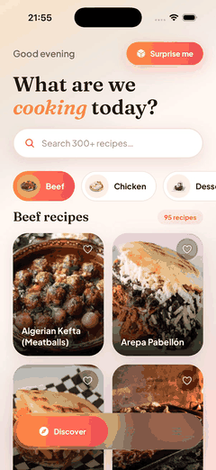
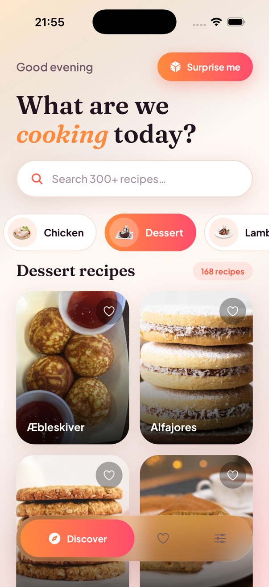
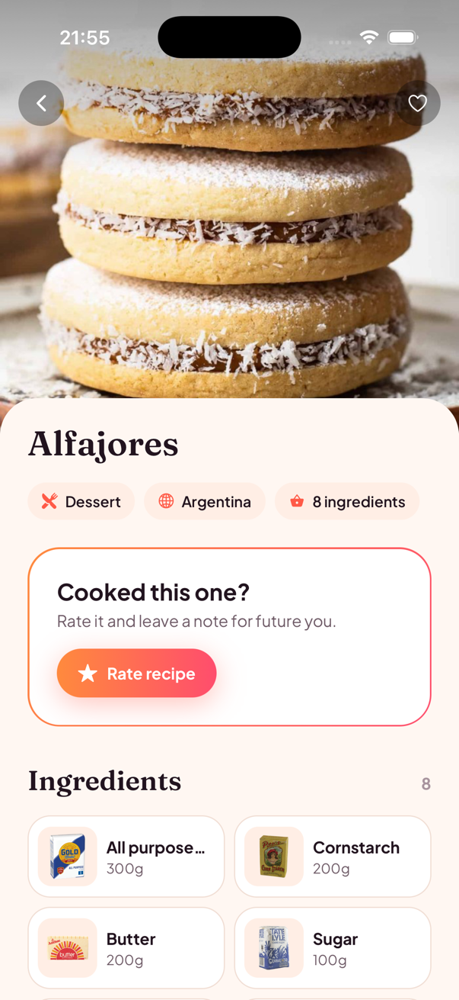

# Savora for React Native

A cross-platform recipe explorer in React Native and TypeScript, built with Expo
as an architecture showcase. It browses [TheMealDB](https://www.themealdb.com/api.php)
(public, no API key), lets you save recipes and rate/review them, works offline
from cache, and ships in English and Serbian with light and dark themes.

Savora exists in four stacks with the same features, design and behaviour, so
the code can be compared side by side:

|                        Flutter                        |                              iOS                              |                                Android                                | **React Native (this repo)** |
| :---------------------------------------------------: | :-----------------------------------------------------------: | :-------------------------------------------------------------------: | :--------------------------: |
| [savora](https://github.com/LugonjaAleksandar/savora) | [savora-ios](https://github.com/LugonjaAleksandar/savora-ios) | [savora-android](https://github.com/LugonjaAleksandar/savora-android) |      Expo · TypeScript       |

## Demo

<p align="center">
  
</p>

A walkthrough of the Release build on the iPhone 17 Pro simulator (iOS 26), with the pauses between taps cut out. It shows the spring-animated category picker, a recipe with its parallax header, a 5-star review in a native form sheet, swipe-to-remove with undo on the Saved tab, and a live switch to dark mode and Serbian. A sharper version is in [`docs/showcase.mp4`](docs/showcase.mp4).

|                                                     Discover                                                      |                                                        Recipe                                                         |                                                   Review                                                   |                                        Settings (dark, Serbian)                                         |
| :---------------------------------------------------------------------------------------------------------------: | :-------------------------------------------------------------------------------------------------------------------: | :--------------------------------------------------------------------------------------------------------: | :-----------------------------------------------------------------------------------------------------: |
|  |  |  |  |

## Features

- **Discover**: category chips with a spring-animated gradient selector, a debounced search, a 2-column grid with staggered entrance animations, pull to refresh and a "Surprise me" random pick.
- **Recipe detail**: a parallax header that stretches on overscroll, a content sheet that rises in, ingredient tiles, a step-by-step timeline, and YouTube/source links.
- **Rate & review**: 1–5 stars plus a note in a native iOS form sheet (`presentation: 'formSheet'`). Stored on the device, with edit and delete.
- **Saved**: favourites persisted with their full summary, so the tab renders offline. Swipe to remove, with undo and layout animations.
- **Settings**: theme (system/light/dark) and language (system/English/Srpski), both persisted and applied instantly. The first launch is in English.
- **Glass tab bar**: a blurred floating bar whose gradient pill slides and stretches between tabs on the UI thread.
- The same typefaces as the Flutter app (Fraunces and Plus Jakarta Sans), and the same palette.
- **Offline-first caching**: see [Caching](#caching).

## Running

Requires Node 20.19+ and, for native builds, Xcode 26 or Android Studio. The native `ios/` and `android/` folders are generated by Expo (Continuous Native Generation), so they are not committed.

```bash
npm install
npx expo run:ios
```

```bash
npx expo run:android
```

Build from a folder whose path has no spaces: one of Expo's iOS build scripts (`expo-constants`) does not quote paths.

Quality gates (also run in CI, see `.github/workflows/ci.yml`):

```bash
npm run format:check
npm run lint
npm run typecheck
npm test
```

TypeScript runs in `strict` mode with `noUncheckedIndexedAccess`, and ESLint includes the React Compiler rules.

## Tech stack

| Concern    | Choice                                                                                     |
| ---------- | ------------------------------------------------------------------------------------------ |
| Framework  | Expo SDK 56, React Native 0.85 (New Architecture), React 19                                |
| Navigation | expo-router: file-based routes, native stack, native form sheet, custom tab bar            |
| State      | Zustand stores (persisted) for app-wide state; a `useReducer` hook for the Discover screen |
| Animation  | Reanimated 4 (UI-thread animations, layout animations), Gesture Handler 2                  |
| Data       | `fetch` behind an injectable `ApiClient`, AsyncStorage                                     |
| UI         | expo-image (memory + disk cache), expo-blur, expo-linear-gradient, expo-haptics            |
| i18n       | i18next + react-i18next, `Intl.PluralRules` for Serbian plurals                            |
| Tests      | Jest (jest-expo), React Native Testing Library                                             |

## Architecture

Route files under `app/` are thin: they own navigation and nothing else. Feature code lives under `src/`, organised by feature:

```
app/                          # expo-router routes (navigation only)
├── _layout.tsx               # root: fonts, container, theme, language, stack, toasts
├── (tabs)/                   # Discover, Saved, Settings + the custom tab bar
├── meal/[id].tsx             # recipe detail
└── review/[id].tsx           # review sheet (native form sheet)
src/
├── core/
│   ├── network/              # ApiClient, Result<T>, AppFailure union
│   ├── storage/              # KeyValueStore interface (AsyncStorage / in-memory)
│   ├── di/                   # composition root + typed store hooks
│   ├── i18n/                 # i18next setup, en.json + sr.json
│   ├── theme/                # tokens, fonts, light/dark colors
│   └── components/           # glass tab bar, SlidingSelector, toasts, primitives
└── features/
    ├── meals/                # models, API decoding, cache, repository
    ├── discover/             # DiscoverScreen, useDiscover, components (cards, chips, search)
    ├── detail/               # MealDetailScreen, useMealDetail, components (ingredient tiles)
    ├── reviews/              # store, section, sheet
    ├── favorites/            # store, Saved screen, tiles
    └── settings/             # store, screen
```

Data flows one way:

```
Screen ──intent──▶ hook / store ──▶ Repository (interface) ──▶ MealsApi ──▶ ApiClient ──▶ fetch
  ▲                     │                  └──────────────▶ MealsCache ──▶ KeyValueStore (AsyncStorage)
  └────── state ────────┘
```

### Key decisions

| Decision                                                                                                                                     | Why                                                                                                                                |
| -------------------------------------------------------------------------------------------------------------------------------------------- | ---------------------------------------------------------------------------------------------------------------------------------- |
| **One composition root (`createContainer`) provided through context.** Stores are created per container, not as module singletons.           | Every dependency is explicit, and tests build a container (or a single store) with in-memory storage and a stubbed `fetch`.        |
| **Repositories are interfaces; screens depend only on the interface.**                                                                       | Tests use fakes, and swapping local storage for a backend would not touch screens.                                                 |
| **`Result<T>` + a closed `AppFailure` union instead of thrown errors.**                                                                      | A `switch` over the failure is exhaustive under `strict`, and the UI maps failures to localised copy, never to raw error messages. |
| **JSON is decoded at the boundary** (`MealsApi`), never cast.                                                                                | A malformed payload becomes `AppFailure.parsing` instead of an `undefined` crash deep in the UI.                                   |
| **Restartable loads.** Every load aborts the previous request with an `AbortController`, and search waits 350 ms before hitting the network. | A slow response can never overwrite a newer selection, and typing does not fire a request per keystroke.                           |
| **Only route files navigate.** Screens receive callbacks such as `onOpenMeal`; cards and tiles expose `onPress`.                             | Components stay reusable and testable, and navigation lives in one place per route.                                                |
| **List items in their own files** (`MealCard`, `CategoryChip`, `FavoriteTile`, `IngredientTile`).                                            | Each one is easy to find, test and reuse.                                                                                          |
| **Animations run on the UI thread** (Reanimated shared values), using the React-Compiler-safe `.get()/.set()` API.                           | Smooth at 60/120 fps even while JS is busy, and compatible with the React Compiler rules.                                          |

### Caching

`DefaultMealsRepository` uses a different strategy for each kind of data:

| Data             | Strategy                                        | TTL    |
| ---------------- | ----------------------------------------------- | ------ |
| Categories       | cache-first                                     | 1 day  |
| Meal detail      | cache-first (also warmed by "Surprise me")      | 7 days |
| Category listing | network-first, stale cache on a network failure | —      |
| Search           | network only                                    | —      |

`MealsCache` stores JSON with a timestamp in AsyncStorage. If an entry is corrupt, it is dropped instead of crashing. expo-image keeps photos in its memory and disk caches, so they render offline once seen.

### Localisation

`en.json` and `sr.json` are generated from the same ARB files as the Flutter app, so all four apps say exactly the same thing. Plurals use i18next's `_zero/_one/_few/_other` keys, so Serbian gets "1 recept", "3 recepta", "5 recepata". "System" follows the device language when it is supported and falls back to English.

## Testing

32 Jest tests run in a few seconds without a simulator or network:

- `ApiClient` + `MealsApi` with a stubbed `fetch`: query building, and mapping 404/5xx/bad JSON/offline to typed failures.
- `DefaultMealsRepository`: cache TTL hits and expiry, offline fallback, server errors not being masked by cache, cache warming by the random pick, and corrupt entries being dropped.
- `useDiscover` (React Native Testing Library): initial load, category switching, **search debouncing** with fake timers (only the last query reaches the repository), the failure path, and the random pick being returned rather than navigated to.
- Meal parsing, favourites (persistence and the undo position), reviews, settings (English on first launch, "System" remembered) and Serbian/English plurals.
- `ToastHost`: pressing **Undo** runs the action and restores the removed recipe (with Reanimated's Jest mocks).
- Serbian dates are formatted in Latin script (`sr-Latn`), matching the copy.

## Possible next steps

- Component tests for the screens with a test container.
- A shared-element transition from the grid into the detail header once Reanimated's shared transitions are stable.
- Syncing reviews to a backend behind the same store interface.

---

Data and images © [TheMealDB](https://www.themealdb.com).
